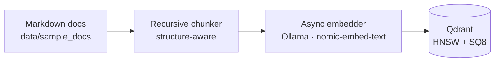
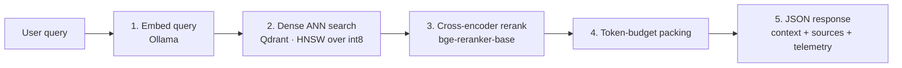

# rag-memory-optimizer

**A memory-efficient, token-budgeted RAG backend.**
Qdrant HNSW + 8-bit scalar quantization → cross-encoder reranking → hard token-budget context packing.


[Overview](#overview) · [Architecture](#architecture) · [Quick Start](#quick-start) · [API](#api-reference) · [Design Decisions](#design-decisions) · [Limitations](#limitations--roadmap)

</div>

---

## Overview

Most RAG demos work on five documents. At real scale, three things hurt first:

| Problem | What goes wrong | How this project addresses it |
|---|---|---|
| **Vector RAM cost** | `float32` embeddings are expensive to hold in memory | HNSW index with **int8 scalar quantization (SQ8)**: ~4x smaller vectors in RAM |
| **Noisy retrieval** | Embedding similarity alone returns loosely related chunks | **Cross-encoder reranking** re-scores each query-chunk pair |
| **Token spend** | Dumping every candidate into the prompt inflates cost and dilutes context | **Token-budget packer** fits the best chunks under a hard limit |

Every response also returns **telemetry** (candidates evaluated, chunks packed, tokens used vs. budget) so the pipeline's behavior is visible per request.

---

## Architecture


### Ingestion (offline)



### Query (online, `POST /query`)



| Step | Component | Responsibility |
|---|---|---|
| 1 | `embedder.py` | Embeds the query asynchronously via Ollama (`nomic-embed-text`, 768-d) |
| 2 | `vector_store.py` | Qdrant ANN search over the quantized HNSW index, returns `top_k_candidates` |
| 3 | `rerank.py` | `BAAI/bge-reranker-base` re-scores candidates, keeps `final_top_k` |
| 4 | `rerank.py` | Packs chunks in rank order until `max_token_budget` is reached |
| 5 | `evaluator.py` | Computes telemetry and assembles the response |

---

## Design Decisions

### 1. Memory: HNSW + SQ8, tiered storage

- **HNSW** gives approximate nearest-neighbor search instead of an O(N) exact scan.
- **SQ8** stores each dimension as `int8` instead of `float32`:

| | Per vector (768-d) | 1M vectors |
|---|---|---|
| `float32` | 3,072 B | ~3.1 GB |
| `int8` (SQ8) | 768 B | ~0.77 GB |

- **Tiering:** quantized vectors stay in RAM (`always_ram=True`) for fast graph traversal; original `float32` vectors are kept on disk (`on_disk=True`).
- **Trade-off:** quantization can reduce recall slightly. This is a known cost of SQ8 and the reason a benchmark is on the roadmap.

### 2. Precision: two-stage retrieval

Fast bi-encoder search casts a wide net; a slower cross-encoder then scores each query-chunk pair jointly. The extra compute is spent only on a small candidate set, which keeps latency bounded while improving relevance.

### 3. Cost: hard token budget

Chunks are packed in rank order and the loop stops at `max_token_budget`, so prompt size is predictable regardless of how many candidates were retrieved. Token count is estimated at ~4 characters per token (a fast heuristic, not a tokenizer-exact count).

### 4. Concurrency

Async FastAPI with `httpx` and `asyncio.gather` keeps embedding calls non-blocking during ingestion and querying.

---

## Quick Start

### Prerequisites

- Python 3.10+
- [Ollama](https://ollama.com) running locally, with the embedding model pulled:
  ```bash
  ollama pull nomic-embed-text
  ```
- A [Qdrant Cloud](https://cloud.qdrant.io) cluster (or a local Qdrant instance)

### 1. Install

```bash
git clone https://github.com/jayant132/rag-memory-optimizer.git
cd rag-memory-optimizer

python3 -m venv venv
source venv/bin/activate
pip install fastapi uvicorn qdrant-client httpx langchain-text-splitters python-dotenv sentence-transformers
```

### 2. Configure

```bash
cp .env.example .env
```

| Variable | Description | Example |
|---|---|---|
| `QDRANT_URL` | Qdrant cluster endpoint | `https://your-cluster.aws.cloud.qdrant.io` |
| `QDRANT_API_KEY` | Qdrant API key | `your_secure_api_key` |
| `EMBEDDING_MODEL_NAME` | Ollama embedding model | `nomic-embed-text` |
| `OLLAMA_BASE_URL` | Ollama server URL | `http://localhost:11434` |

### 3. Ingest documents

```bash
export PYTHONPATH=$PYTHONPATH:.
python3 -m src.ingestion.pipeline
```

### 4. Start the API

```bash
export PYTHONPATH=$PYTHONPATH:.
./venv/bin/python -m uvicorn src.api.main:app --port 8000
```

Interactive docs are available at **http://localhost:8000/docs**.

---

## API Reference

### `GET /system/status`

Liveness check. Returns service name, vector store, and reranker model.

### `POST /query`

**Request**

| Field | Type | Default | Description |
|---|---|---|---|
| `query` | string | required | The user's question |
| `top_k_candidates` | int | `10` | Candidates fetched from Qdrant |
| `final_top_k` | int | `2` | Chunks kept after reranking |
| `max_token_budget` | int | `1000` | Upper bound on packed context size |

```bash
curl -X POST http://localhost:8000/query \
  -H "Content-Type: application/json" \
  -d '{
    "query": "What are the remote work rules for data storage?",
    "top_k_candidates": 4,
    "final_top_k": 2,
    "max_token_budget": 500
  }'
```

**Response** (from a real run)

```json
{
  "query": "What are the remote work rules for data storage?",
  "telemetry": {
    "candidates_evaluated": 4,
    "final_chunks_packed": 2,
    "estimated_input_tokens": 152,
    "token_budget_limit": 500,
    "retrieval_precision_score": 0.01045
  },
  "packed_context": "## 1. Data Governance & Storage\n1.1 All proprietary source code, customer records, and financial projections must remain strictly within approved company cloud environments.\n1.2 Local caching of unencrypted enterprise data on personal devices (BYOD) is strictly prohibited ...",
  "retrieved_sources": [
    "data/sample_docs/enterprise_security_policy.md",
    "data/sample_docs/enterprise_security_policy.md"
  ]
}
```

**Telemetry fields**

| Field | Meaning |
|---|---|
| `candidates_evaluated` | Chunks returned by the vector search |
| `final_chunks_packed` | Chunks kept after reranking |
| `estimated_input_tokens` | Approximate tokens in `packed_context` (~chars / 4) |
| `token_budget_limit` | The `max_token_budget` requested |
| `retrieval_precision_score` | Mean raw cross-encoder score of the kept chunks. This is a heuristic relevance signal, **not** labeled precision, and its scale depends on the reranker's output range |

---

## Project Structure

```text
rag-memory-optimizer/
├── config/
│   └── settings.yaml        # System parameters
├── data/
│   └── sample_docs/         # Source documents (markdown)
├── docs/
│   └── rag-memory-optimizer-architecture.png
├── src/
│   ├── api/
│   │   └── main.py          # FastAPI app, /query pipeline orchestration
│   ├── core/
│   │   └── config.py        # Environment configuration
│   ├── evaluation/
│   │   └── evaluator.py     # Retrieval and token telemetry
│   ├── ingestion/
│   │   ├── chunker.py       # Recursive markdown splitter
│   │   ├── embedder.py      # Async Ollama embedding client
│   │   └── pipeline.py      # Ingestion orchestrator
│   └── retrieval/
│       ├── rerank.py        # Cross-encoder reranker + token-budget packer
│       └── vector_store.py  # Qdrant client and SQ8 collection setup
├── tests/
├── Dockerfile
├── docker-compose.yml
├── pyproject.toml
└── README.md
```

---

## Tech Stack

| Layer | Technology |
|---|---|
| API | FastAPI, Pydantic, Uvicorn |
| Vector database | Qdrant (HNSW, scalar quantization) |
| Embeddings | Ollama, `nomic-embed-text` (768-d) |
| Reranking | `BAAI/bge-reranker-base` via `sentence-transformers` |
| Async I/O | `httpx`, `asyncio` |
| Chunking | `langchain-text-splitters` |

---

## Limitations & Roadmap

This is a proof of concept built on a small corpus, so results here demonstrate that the pipeline works end to end, not production-scale performance.

**Current limitations**

- Evaluated on a single small policy document; no large-corpus benchmark yet.
- Memory savings (~4x) are from the data-type math of SQ8, not a measured benchmark; recall impact is not yet quantified.
- `retrieval_precision_score` is a heuristic, not a labeled metric.
- Token counts are estimated, not tokenizer-exact.
- Requires a local Ollama instance for embeddings.
