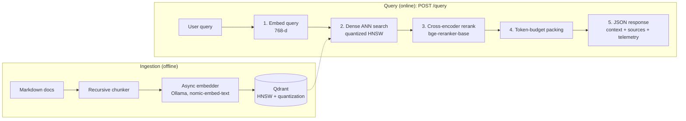

# rag-memory-optimizer

**Shrink RAG vector storage 4-16x with no measurable loss in ranking quality (32x for about 1%), benchmarked on BEIR SciFact.**

A RAG backend built around three production costs: **vector memory**, **retrieval noise** and **prompt tokens**. It combines Qdrant HNSW with selectable quantization, cross-encoder reranking and hard token-budget context packing, served by an async FastAPI app. Includes a reproducible quantization benchmark.


---

## Results at a glance

Measured on **BEIR SciFact** (5,183 documents, 300 labeled queries), 768-d `nomic-embed-text` embeddings, float32 rescoring with 2x oversampling.

| Configuration | Vector size | Compression | nDCG@10 | Change vs. baseline |
|---|---|---|---|---|
| Baseline: float32 | 3,072 B | 1x | 0.683 | n/a |
| SQ8 | 768 B | **4x** | 0.682 | -0.001 |
| TurboQuant 4-bit | 384 B | **8x** | 0.682 | -0.001 |
| TurboQuant 2-bit | 192 B | **16x** | 0.684 | +0.001 (within noise) |
| TurboQuant 1-bit | 96 B | **32x** | 0.676 | -0.007 (about -1%) |
| 256-d + TurboQuant 1-bit | 32 B | **96x** | 0.648 | -0.035 (about -5%) |

> Vector size is the compressed vector only, computed from the storage format. It excludes the HNSW graph and payloads. See [Scope and caveats](#scope-and-caveats).


---

## Key findings

1. **Quantize before you truncate.** 768-d TurboQuant 2-bit is 16x smaller with no measurable quality loss. Truncating to 256-d float32 is only 3x smaller and costs about 3.4% nDCG@10 (0.683 to 0.660).
2. **Overlap with exact search overstates the damage.** For 768-d TurboQuant 1-bit, the top-10 overlap with exact search drops to 0.715, yet nDCG@10 falls only 0.007. SciFact has few relevant documents per query, so many of the "lost" neighbors were not relevant anyway. This gap may be smaller on other datasets.
3. **TurboQuant beats binary at equal size.** At 192 bytes per vector, TurboQuant 2-bit scores nDCG@10 0.684 with 0.851 overlap, vs. 0.670 and 0.707 for binary 2-bit.
4. **Latency is not the story at this scale.** Every configuration answers in a few milliseconds and the differences are within run-to-run noise. Use this benchmark for quality and memory, not speed claims.

### Which configuration should I use?

| Goal | Pick | Why |
|---|---|---|
| Safe default | 768-d SQ8 | 4x smaller, nDCG@10 within 0.001 of float32 |
| Max compression, no measurable loss | 768-d TurboQuant 2-bit | 16x smaller, nDCG@10 0.684 |
| Tight memory budget | 768-d TurboQuant 1-bit | 32x smaller for about 1% nDCG@10 |
| Avoid if quality matters | 256-d truncation | Larger quality loss than quantization for far less compression |

These results come from one dataset. Validate on your own data before choosing.

---

## Why this exists

Most RAG demos work on five documents. At real scale, three things hurt first:

| Problem | What goes wrong | What this project does |
|---|---|---|
| Vector memory | float32 embeddings are expensive to keep in RAM | HNSW index with selectable quantization (SQ8 by default; TurboQuant and binary benchmarked) |
| Noisy retrieval | Embedding similarity alone returns loosely related chunks | Cross-encoder reranking scores each query-chunk pair |
| Token spend | Dumping every candidate into the prompt inflates cost | A packer fits the best chunks under a hard token limit |

Every response also returns telemetry: candidates evaluated, chunks packed, tokens used vs. budget.

### What 1 million vectors would cost (computed)

Vector storage only, calculated from the storage format (not a measured RAM figure):

| Configuration | Bytes / vector | 1M vectors |
|---|---|---|
| 768-d float32 | 3,072 | 3.07 GB |
| 768-d SQ8 | 768 | 0.77 GB |
| 768-d TurboQuant 4-bit | 384 | 0.38 GB |
| 768-d TurboQuant 2-bit | 192 | 0.19 GB |
| 768-d TurboQuant 1-bit | 96 | 0.10 GB |

---

## Architecture



Fast vector search casts a wide net, then the slower cross-encoder scores only that small candidate set, so latency stays bounded.

| Step | Component | Responsibility |
|---|---|---|
| 1 | `src/ingestion/embedder.py` | Async query embedding via Ollama |
| 2 | `src/retrieval/vector_store.py` | Search over the quantized HNSW index |
| 3 | `src/retrieval/rerank.py` | Cross-encoder re-scoring, keeps the top results |
| 4 | `src/retrieval/rerank.py` | Packs chunks in rank order until the token budget is hit |
| 5 | `src/evaluation/evaluator.py` | Computes telemetry for the response |

---

## Full benchmark

### Setup

- **Dataset:** [BEIR SciFact](https://github.com/beir-cellar/beir), 5,183 documents and 300 test queries with human relevance labels.
- **Embeddings:** `nomic-embed-text` via Ollama (768-d), using the model's `search_document:` and `search_query:` task prefixes. The 256-d variant is built by Matryoshka truncation (layer norm, truncate, L2 normalize).
- **Search settings:** HNSW `ef=128`, rescoring on, 2x oversampling (a 1x run is available via a flag).
- **Configurations:** float32 (kept in RAM, the baseline), SQ8, TurboQuant at 4, 2 and 1 bit, and 2-bit binary quantization, at 768 and 256 dimensions.

### Metrics

| Metric | Definition |
|---|---|
| overlap@10 | Overlap of the top 10 with **exact float32 search** over the same vectors. Isolates what truncation and quantization cost, independent of the dataset labels |
| nDCG@10 | Ranking quality against the human relevance labels |
| p50 / p95 latency | Single-query, sequential, after 20 warm-up queries |
| Bytes / vector | **Computed from the storage format**, not measured |

### Results (2x oversampling, rescoring enabled)

| Config | Bytes / vector | Compression | overlap@10 | nDCG@10 | p50 ms | p95 ms |
|---|---|---|---|---|---|---|
| 768-d float32 | 3,072 | 1x | 0.998 | 0.683 | 8.9 | 13.3 |
| 768-d SQ8 | 768 | 4x | 0.972 | 0.682 | 9.5 | 24.0 |
| 768-d TurboQuant 4-bit | 384 | 8x | 0.956 | 0.682 | 7.2 | 13.6 |
| 768-d TurboQuant 2-bit | 192 | 16x | 0.851 | 0.684 | 7.6 | 20.7 |
| 768-d TurboQuant 1-bit | 96 | 32x | 0.715 | 0.676 | 6.5 | 17.0 |
| 768-d binary (2-bit) | 192 | 16x | 0.707 | 0.670 | 6.5 | 8.7 |
| 256-d float32 | 1,024 | 3x | 1.000 | 0.660 | 4.2 | 6.3 |
| 256-d SQ8 | 256 | 12x | 0.956 | 0.660 | 4.6 | 7.2 |
| 256-d TurboQuant 4-bit | 128 | 24x | 0.932 | 0.664 | 4.6 | 6.7 |
| 256-d TurboQuant 2-bit | 64 | 48x | 0.783 | 0.661 | 4.4 | 16.5 |
| 256-d TurboQuant 1-bit | 32 | 96x | 0.593 | 0.648 | 4.4 | 6.2 |

Compression is relative to 768-d float32 (3,072 B).

### Scope and caveats

- **Rescoring.** Quantized search proposes candidates (2x the requested number) and the original float32 vectors rescore them, so the table shows quantization as candidate generation followed by exact ranking. The compressed index is smaller, but the originals must still be stored, on disk if you want to save RAM.
- **Memory is computed, not measured.** Bytes per vector cover the compressed vector only. The HNSW graph and payloads cost extra and can matter at very small vector sizes. Total process RAM at larger scale has not yet been measured.
- **Small corpus.** 5,183 documents and 300 queries. Differences of about 0.002 nDCG@10 are likely noise, and confidence intervals are not computed.
- **Latency** differences are within run-to-run noise at this size, including the p95 outliers.
- **One dataset and one embedding model.** Results may differ on other domains.

### Reproduce

```bash
export PYTHONPATH=.

# 1. Embed the corpus once (cached)
python benchmark/embed_corpus.py --n 5183

# 2. Run the benchmark
python benchmark/run_benchmark.py                       # 2x oversampling
python benchmark/run_benchmark.py --oversampling 1.0    # quantization alone

# 3. Regenerate the chart
python benchmark/plot_tradeoff.py
```

Results are written to `benchmark/results.json` and printed as a markdown table.

---

## Quick start

**Prerequisites:** Python 3.10+, [Ollama](https://ollama.com), Docker (for a local Qdrant).

```bash
# 1. Services
ollama pull nomic-embed-text
docker run -d --name qdrant -p 6333:6333 qdrant/qdrant

# 2. Install
git clone https://github.com/jayant132/rag-memory-optimizer.git
cd rag-memory-optimizer
python3 -m venv venv && source venv/bin/activate
pip install fastapi uvicorn qdrant-client httpx langchain-text-splitters \
            python-dotenv sentence-transformers numpy

# 3. Configure (the defaults work for a local setup)
cp .env.example .env

# 4. Ingest the sample documents
export PYTHONPATH=.
python -m src.ingestion.pipeline

# 5. Start the API
uvicorn src.api.main:app --port 8000
```

Interactive docs: http://localhost:8000/docs

### Configuration

| Variable | Default | Description |
|---|---|---|
| `QDRANT_URL` | `http://localhost:6333` | Qdrant endpoint (use your cluster URL for Qdrant Cloud) |
| `QDRANT_API_KEY` | none | Only needed for Qdrant Cloud |
| `OLLAMA_BASE_URL` | `http://localhost:11434` | Ollama server |
| `EMBEDDING_MODEL_NAME` | `nomic-embed-text` | Embedding model |
| `EMBEDDING_DIM` | `768` | Vector size |
| `COLLECTION_NAME` | `rag_memory_index` | Qdrant collection |

---

## API

### `GET /system/status`

Liveness check. Returns the service name, vector store and reranker model.

### `POST /query`

| Field | Type | Default | Description |
|---|---|---|---|
| `query` | string | required | The user's question |
| `top_k_candidates` | int | 10 | Candidates fetched from Qdrant |
| `final_top_k` | int | 2 | Chunks kept after reranking |
| `max_token_budget` | int | 1000 | Upper bound on packed context size |

```bash
curl -X POST http://localhost:8000/query \
  -H "Content-Type: application/json" \
  -d '{
    "query": "What are the remote work rules for data storage?",
    "top_k_candidates": 4,
    "final_top_k": 2,
    "max_token_budget": 500
  }'
```

Example response (context shortened):

```json
{
  "query": "What are the remote work rules for data storage?",
  "telemetry": {
    "candidates_evaluated": 4,
    "final_chunks_packed": 2,
    "estimated_input_tokens": 152,
    "token_budget_limit": 500,
    "retrieval_precision_score": 0.01045
  },
  "packed_context": "## 1. Data Governance & Storage\n1.1 All proprietary source code ...",
  "retrieved_sources": ["data/sample_docs/enterprise_security_policy.md"]
}
```

| Telemetry field | Meaning |
|---|---|
| `candidates_evaluated` | Chunks returned by the vector search |
| `final_chunks_packed` | Chunks kept after reranking |
| `estimated_input_tokens` | Approximate tokens in `packed_context` (characters / 4) |
| `token_budget_limit` | The requested `max_token_budget` |
| `retrieval_precision_score` | Mean raw cross-encoder score of the kept chunks. This is an unnormalized reranker output, useful for comparing chunks against each other, not a probability or labeled precision |

---

## Design decisions

| Decision | Why | Trade-off |
|---|---|---|
| Quantized HNSW with float32 originals on disk | HNSW avoids an O(N) scan; quantized vectors in RAM keep graph traversal fast and small | Originals must still be stored (on disk) for rescoring |
| Rescoring with 2x oversampling | Recovers ranking quality lost to compression | Slightly more work per query |
| Two-stage retrieval | Wide, cheap vector search first; the cross-encoder runs only on a small candidate set | Adds reranker latency per query |
| Hard token budget | Chunks are packed in rank order and packing stops at `max_token_budget`, so prompt size is predictable | Token counts are estimated (about 4 characters per token) |
| Task prefixes in the embedding client | `nomic-embed-text` needs `search_document:` / `search_query:` prefixes; omitting them lowers retrieval quality | Must stay consistent between ingestion and query |
| Async, batched embedding with bounded concurrency | Keeps ingestion and queries non-blocking | More moving parts than a sync client |

---

## Project structure

```
rag-memory-optimizer/
├── benchmark/
│   ├── embed_corpus.py        # embeds SciFact once and caches the vectors
│   ├── run_benchmark.py       # quantization sweep: overlap, nDCG, latency
│   ├── plot_tradeoff.py       # generates tradeoff.png
│   └── tradeoff.png           # memory vs. quality chart
├── config/settings.yaml       # system parameters
├── data/sample_docs/          # source documents (markdown)
├── src/
│   ├── api/main.py            # FastAPI app and /query pipeline
│   ├── core/config.py         # environment configuration
│   ├── evaluation/evaluator.py    # retrieval and token telemetry
│   ├── ingestion/             # chunker, embedder, ingestion pipeline
│   └── retrieval/
│       ├── rerank.py          # cross-encoder reranker + token-budget packer
│       └── vector_store.py    # Qdrant client and quantized collection setup
├── tests/
├── Dockerfile
├── docker-compose.yml
├── pyproject.toml
└── README.md
```

---

## Limitations and roadmap

**Current limitations**

- The API was exercised on a single small policy document. Retrieval quality at scale is measured by the benchmark on SciFact only.
- Memory figures are computed from the storage format. Total process RAM, including the HNSW graph, has not been measured.
- `retrieval_precision_score` is a heuristic, not a labeled metric.
- Token counts are estimated, not tokenizer-exact.
- Requires a running Ollama instance for embeddings.

**Roadmap**

- [ ] Measure real RAM at 500K to 1M vectors, including the HNSW graph
- [ ] Publish the 1x oversampling (quantization alone) table
- [ ] Ablation: nDCG with and without the reranker, and tokens saved by the packer vs. naive top-k
- [ ] Exact token counting with `tiktoken`
- [ ] GitHub Actions CI (tests and a small smoke benchmark)
- [ ] Hybrid search (BM25 + dense)

---

## License

MIT. See [LICENSE](LICENSE).
